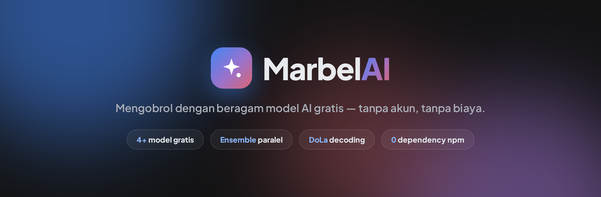
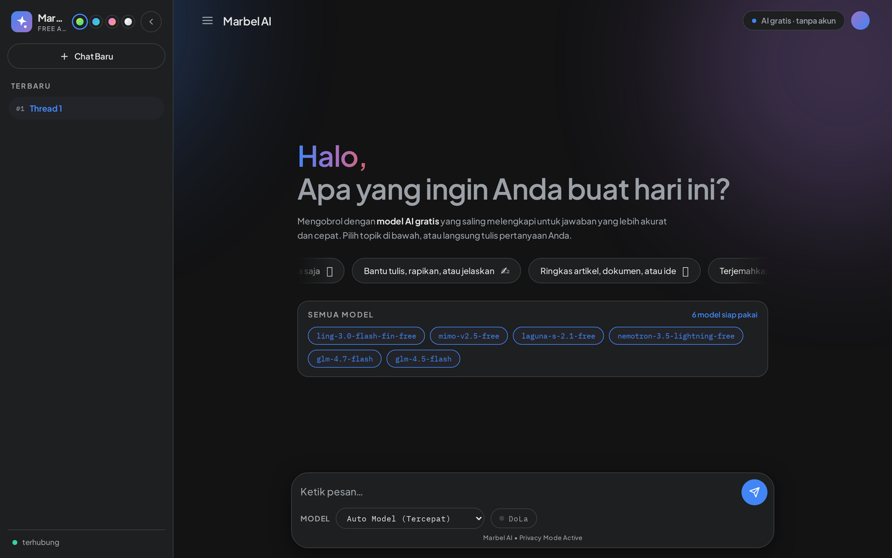
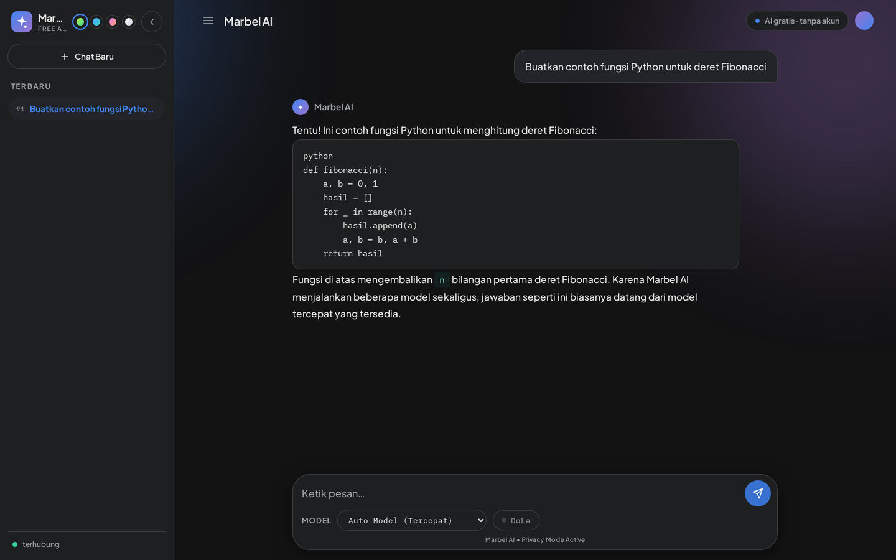
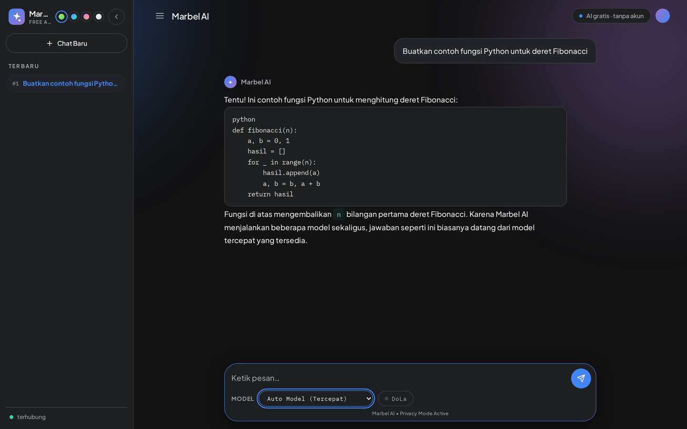
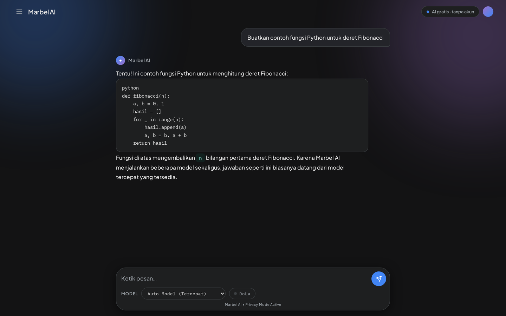
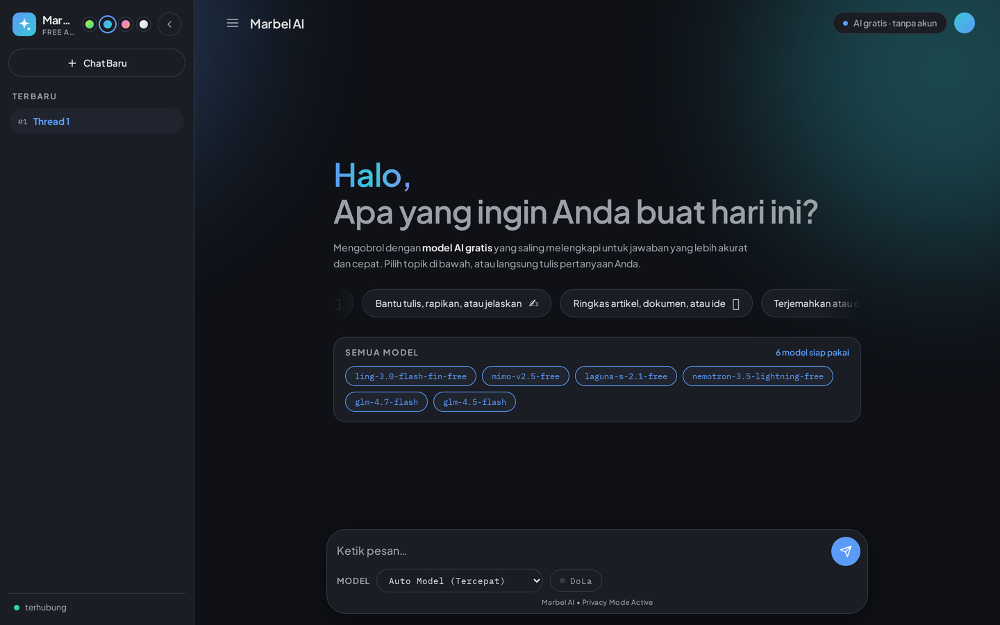
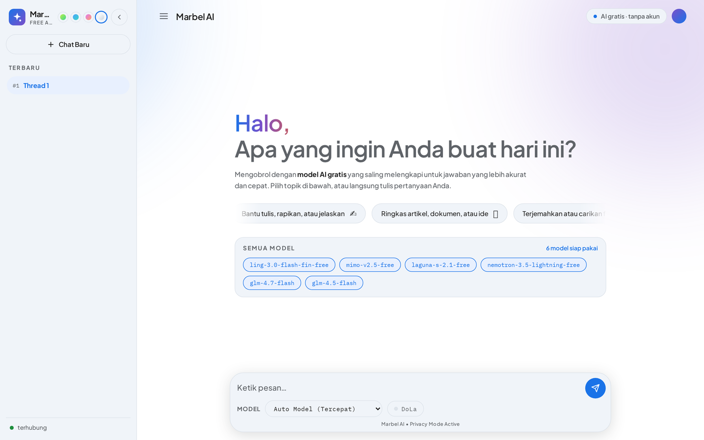
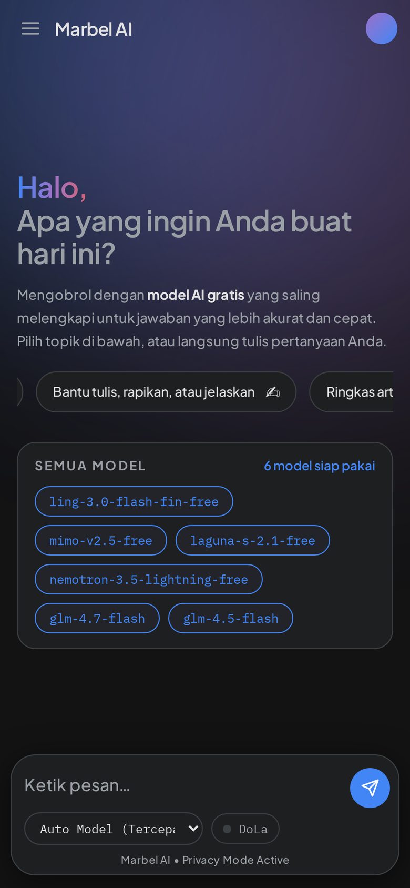
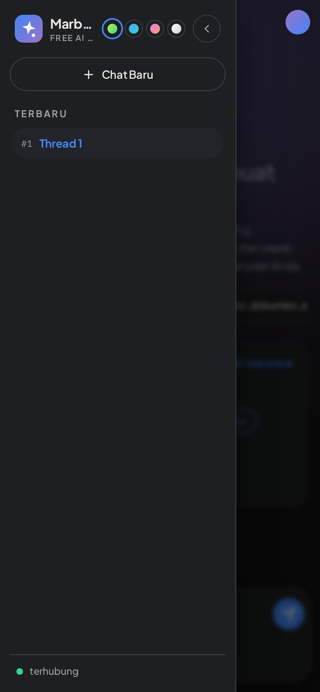

<div align="center">



# Marbel AI

**Mengobrol dengan beragam model AI gratis — tanpa akun, tanpa biaya.**

Satu antarmuka, banyak model. Marbel AI menjalankan beberapa model gratis secara
**paralel** lalu memakai jawaban **tercepat yang berhasil**, dengan cadangan
otomatis bila ada provider yang sibuk. Ada juga mode **DoLa** untuk jawaban yang
lebih faktual.

[](https://antono4.github.io/MarbelAI/)
[](https://marbel-ai.onrender.com)
[](LICENSE)
[](https://nodejs.org)

</div>

---

## Daftar Isi

- [Apa itu Marbel AI](#apa-itu-marbel-ai)
- [Tangkapan Layar](#tangkapan-layar)
- [Fitur Utama](#fitur-utama)
- [Cara Kerja Singkat](#cara-kerja-singkat)
- [Mulai Cepat](#mulai-cepat)
- [Model yang Dipakai](#model-yang-dipakai)
- [Mode DoLa](#mode-dola)
- [Konfigurasi (Environment Variables)](#konfigurasi-environment-variables)
- [Referensi API](#referensi-api)
- [Docker](#docker)
- [Deployment](#deployment)
- [Pengujian](#pengujian)
- [Struktur Proyek](#struktur-proyek)
- [Pemecahan Masalah](#pemecahan-masalah)
- [Lisensi](#lisensi)

---

## Apa itu Marbel AI

Marbel AI adalah aplikasi chat AI ringan yang terdiri dari dua bagian:

1. **Frontend statis** (`index.html`, `app.js`, `styles.css`) — antarmuka chat
   bertema gelap, bisa dibuka langsung dari file statis atau GitHub Pages.
2. **Backend Node.js** (`server.js`) — server file statis sekaligus **proxy**
   ke endpoint **OpenAI-compatible**. Backend inilah yang menyimpan kunci API
   dan menangani fallback antar-provider.

Karena semua lalu lintas model lewat satu proxy, frontend tidak perlu tahu
detail provider mana yang sedang dipakai. Ganti upstream cukup dengan mengubah
satu variabel lingkungan.

> **Tanpa dependency npm.** Seluruh backend memakai modul bawaan Node.js
> (`http`, `https`, `fs`, `path`). `npm install` tidak diperlukan untuk menjalankan
> server.

---

## Tangkapan Layar

**Layar sambutan** — pilih topik cepat atau langsung tulis pertanyaan. Di bawahnya
terlihat daftar model yang siap dipakai.



**Percakapan dengan blok kode** — jawaban dari model ditampilkan rapi, termasuk
blok kode yang otomatis diformat.



**Pemilih model** — pilih `Auto Model (Tercepat)` untuk mode ensemble, atau kunci
satu model tertentu.



**Area chat lebar** — sidebar bisa disembunyikan agar area percakapan lebih luas.



**Empat tema bawaan** — `green` (default), `ocean`, `sunset`, dan `light`.

| Malam Hijau (default) | Laut Biru | Terang |
|:---:|:---:|:---:|
|  |  |  |

**Tampilan ponsel** — sidebar berubah menjadi *drawer* dengan lapisan *scrim*.

| Layar sambutan | Sidebar terbuka |
|:---:|:---:|
|  |  |

---

## Fitur Utama

- **Ensemble multi-model paralel** — beberapa model gratis dijalankan sekaligus
  dalam batch kecil (maks 2 per batch), lalu jawaban **tercepat yang sukses**
  yang dipakai. Model yang lambat tidak menahan jawaban.
- **Fallback berlapis** — bila provider utama gagal (4xx/5xx, timeout, atau
  balasan "HTTP 200 berisi error"), permintaan dicoba ulang ke provider cadangan
  (Z.ai/GLM bila tersedia), lalu ke model berikutnya.
- **Retry dengan backoff** — dua gelombang percobaan penuh dengan backoff
  eksponensial berjitter (~1,2 detik lalu ~2 detik) plus jeda pendinginan
  antar-gelombang, sehingga gangguan sesaat dari provider gratis tetap terlewati.
- **Riwayat percakapan** — beberapa *thread* dalam satu sesi, bisa dibuka dan
  dilanjutkan; nama thread diambil dari pesan pertama.
- **Antarmuka modern** — empat tema, sidebar *drawer* responsif, strip saran
  berjalan, dan render blok kode.
- **Efek mengetik** — jawaban muncul bertahap agar terasa ringan (bisa
  dilewati di mode paralel supaya tidak menunda pemenang).
- **Tanpa dependency npm** — mudah diaudit dan cepat dideploy.
- **Siap deploy** — Render Blueprint, Railway, Docker, dan GitHub Pages.

---

## Cara Kerja Singkat

```
┌────────────────────┐        POST /api/chat         ┌─────────────────────────┐
│  Frontend (app.js) │ ────────────────────────────► │  Backend (server.js)    │
│  index.html + CSS  │                               │  - file statis          │
│  GitHub Pages /    │ ◄──────────────────────────── │  - proxy + fallback     │
│  file lokal        │        JSON jawaban           │  - jalur DoLa           │
└────────────────────┘                               └───────────┬─────────────┘
                                                                 │ OpenAI-compatible
                                                                 ▼
                                                     ┌─────────────────────────┐
                                                     │ UPSTREAM (Zen)          │
                                                     │ + ZAI_UPSTREAM (GLM)    │
                                                     └─────────────────────────┘
```

**Alur satu pesan:**

1. `app.js` mengirim `{ model, messages, stream: false, dola }` ke `POST /api/chat`.
2. Di mode **Auto**, frontend memanggil beberapa model **paralel** dan memakai
   hasil pertama yang sukses (`Promise.any`).
3. `server.js` meneruskan permintaan ke `UPSTREAM`. Bila gagal dan `ZAI_API_KEY`
   tersedia, permintaan dicoba ke `ZAI_UPSTREAM`.
4. Jawaban dibaca dari `message.content`; bila kosong, dicoba
   `message.reasoning_content` lalu `message.reasoning` (sebagian model menaruh
   jawabannya di kolom *reasoning* saat non-streaming).
5. Frontend merender jawaban dan menyimpannya ke riwayat thread.

---

## Mulai Cepat

**Prasyarat:** Node.js **18 atau lebih baru**. Tidak ada `npm install` yang
diperlukan.

```bash
# 1. Ambil kode
git clone https://github.com/antono4/MarbelAI.git
cd MarbelAI

# 2. Jalankan server (UPSTREAM wajib diarahkan ke endpoint OpenAI-compatible)
PORT=12000 UPSTREAM=https://opencode.ai/zen node server.js

# 3. Buka di browser
#    http://localhost:12000
```

Bila `UPSTREAM` tidak diisi, server memakai default `http://localhost:20128`
(cocok untuk pengembangan lokal bersama proxy lain).

**Menjalankan tes:**

```bash
npm test
```

---

## Model yang Dipakai

Marbel AI memakai endpoint gratis dari **Zen** (`https://opencode.ai/zen`) dan
opsional **Z.ai** untuk model GLM. Daftar model di bawah mengikuti kode saat ini
dan dapat berubah kapan saja mengikuti kebijakan provider.

| Model | Sumber | Catatan |
|---|---|---|
| `ling-3.0-flash-fin-free` | Zen | Cepat dan stabil, prioritas utama |
| `mimo-v2.5-free` | Zen | Populer, sesekali kena rate-limit |
| `laguna-s-2.1-free` | Zen | Berhasil tapi lambat (4–9 detik) |
| `nemotron-3.5-lightning-free` | Zen | Sangat lambat (>9 detik), tetap dicoba sebagai cadangan |
| `glm-4.7-flash` | Z.ai | Gratis di API resmi Z.ai, **butuh `ZAI_API_KEY`** |
| `glm-4.5-flash` | Z.ai | Gratis di API resmi Z.ai, **butuh `ZAI_API_KEY`** |

> **Penting:** model GLM **dikunci** di sidebar bila backend tidak memiliki
> `ZAI_API_KEY`. Frontend memeriksa `GET /api/status` untuk menentukan status
> kunci ini, sehingga tidak ada permintaan yang dibuang sia-sia.

---

## Mode DoLa

**DoLa** (*Decoding by Contrasting Layers*, [arXiv:2309.03883](https://arxiv.org/abs/2309.03883))
meningkatkan faktualitas dengan mengontraskan dua distribusi: model **mature**
(kuat/faktual) melawan model **premature** (lemah/tapi lancar).

**Adaptasi yang dipakai di sini.** Paper aslinya mengontraskan antar-*layer* di
dalam satu transformer. Karena Marbel AI hanya klien API OpenAI-compatible,
layer internal tidak bisa diakses. Kontras karena itu diterapkan pada level
**token** di atas `logprobs` dari dua **model** berbeda. Ini secara teknis adalah
*Contrastive Decoding* (baseline di paper), tetapi semua rumus inti DoLa tetap
dipakai:

- Skor kontras `F(q_N, q_M) = log q_N(x) − log q_M(x)`
- *Adaptive Plausibility Constraint* (APC) dengan `alpha`
- *Repetition penalty* dengan `theta`
- Penjajaran token mature vs premature memakai **LCS** (`lcsAlign`) agar kontras
  hanya diterapkan pada posisi yang konteksnya cocok

**Fallback aman.** Bila provider tidak mengirim `logprobs`, `runDola`
mengembalikan `null` dan proxy lanjut ke dekode biasa. Jadi DoLa tidak pernah
lebih buruk dari baseline — hanya kadang lebih lambat.

**Cara menyalakan:**

- Tombol **DoLa** di composer (preferensi disimpan di `localStorage` sebagai
  `marbel-dola`; timeout klien dinaikkan ke 75 detik), atau
- `DOLA_ENABLED=1` di server untuk menyalakan sebagai default, atau
- Kirim `{"dola": true}` pada payload `/api/chat`.

> DoLa hanya aktif untuk permintaan **non-streaming**. Hasilnya menyertakan
> diagnostik `marbel_dola` (`changed`, `meanJsd`, `aligned`, `tokens`).

---

## Konfigurasi (Environment Variables)

Salinan lengkap ada di [`.env.example`](.env.example).

| Variabel | Default | Deskripsi |
|---|---|---|
| `PORT` | `12000` | Port HTTP server |
| `UPSTREAM` | `http://localhost:20128` | Base URL endpoint OpenAI-compatible utama (contoh Zen: `https://opencode.ai/zen`) |
| `API_KEY` | *(kosong)* | Kunci API upstream utama. Boleh kosong bila upstream tidak memerlukannya |
| `ZAI_UPSTREAM` | `https://api.z.ai/api/paas/v4` | Base URL cadangan Z.ai (GLM) |
| `ZAI_API_KEY` | *(kosong)* | Kunci API Z.ai. Model GLM aktif hanya bila ini diisi |
| `ALLOW_ORIGIN` | `*` | Origin yang diizinkan untuk CORS |
| `USE_SSE` | `0` di `.env.example`, `1` di kode | `1` = mode streaming, `0` = JSON biasa |
| `LOG_CHAT` | *(kosong)* | Set `1` untuk mencatat setiap request chat di konsol backend |
| `DOLA_ENABLED` | `0` | `1` = DoLa aktif sebagai default di server |
| `DOLA_MATURE_MODEL` | `glm-4.7-flash` | Model mature (kuat/faktual) untuk kontras |
| `DOLA_PREMATURE_MODEL` | `ling-3.0-flash-fin-free` | Model premature (lemah/lancar) untuk kontras |
| `DOLA_ALPHA` | `0.1` | Nilai `alpha` untuk Adaptive Plausibility Constraint |
| `DOLA_REPETITION_PENALTY` | `1.2` | Nilai `theta` untuk repetition penalty |
| `DOLA_TOP_LOGPROBS` | `20` | Jumlah alternatif `logprobs` per token |

> **Catatan `USE_SSE`:** kode memakai `1` sebagai default, sementara
> `.env.example` dan `render.yaml` menyetelnya ke `0`. Frontend selalu mengirim
> `stream: false`, jadi jalur JSON yang dipakai.

---

## Referensi API

| Endpoint | Metode | Deskripsi |
|---|---|---|
| `/` | `GET` | UI statis (`index.html`) |
| `/api/models` | `GET` | Daftar model dari upstream (timeout 15 detik, fallback ke Z.ai) |
| `/api/status` | `GET` | Status backend: ketersediaan kunci Z.ai, upstream aktif, mode SSE |
| `/api/chat` | `POST` | Proxy ke `/v1/chat/completions` upstream (timeout 30 detik) |

**Contoh permintaan chat:**

```bash
curl -X POST http://localhost:12000/api/chat \
  -H "Content-Type: application/json" \
  -d '{
    "model": "ling-3.0-flash-fin-free",
    "messages": [{ "role": "user", "content": "Halo, siapa kamu?" }]
  }'
```

**Contoh dengan DoLa aktif:**

```bash
curl -X POST http://localhost:12000/api/chat \
  -H "Content-Type: application/json" \
  -d '{
    "model": "ling-3.0-flash-fin-free",
    "stream": false,
    "dola": true,
    "messages": [{ "role": "user", "content": "Ibu kota Washington?" }]
  }'
```

**Contoh respons `/api/status`:**

```json
{
  "zai": { "available": false },
  "upstream": "https://opencode.ai/zen",
  "use_sse": true
}
```

---

## Docker

```bash
docker build -t marbel-ai .

docker run -p 10000:10000 \
  -e PORT=10000 \
  -e UPSTREAM=https://opencode.ai/zen \
  marbel-ai
```

Buka `http://localhost:10000`.

---

## Deployment

| Platform | Cara pakai |
|---|---|
| **Render** | Jadikan `render.yaml` sebagai *Blueprint*. Isi `ZAI_API_KEY` di dashboard bila ingin model GLM ikut melayani. |
| **Railway** | Pakai `railway.json`. Set `UPSTREAM` dan `PORT` di variabel lingkungan. |
| **GitHub Pages** | Frontend statis langsung jalan dari branch `master` (folder `/`). Backend default `https://marbel-ai.onrender.com`, bisa ditimpa dengan query `?backend=URL`. |
| **Docker** | Lihat bagian [Docker](#docker) di atas. |

**Catatan GitHub Pages.** Saat frontend dibuka dari `github.io`, `app.js` otomatis
mengarahkan permintaan API ke backend (default Render) dan menyediakan fallback
bila backend tersebut tidak merespons. Untuk backend sendiri, cukup buka:

```
https://antono4.github.io/MarbelAI/?backend=https://backend-anda.example.com
```

---

## Pengujian

```bash
npm test
```

Tes memakai `node:test` bawaan Node.js (tanpa framework tambahan):

- `test/dola.test.js` — unit test inti DoLa: normalisasi `logprobs`, JSD, APC,
  penjajaran LCS, repetition penalty, dan `dolaDecode`.
- `test/server.test.js` — tes integrasi: menjalankan `server.js` dengan upstream
  tiruan yang mengembalikan `logprobs`, lalu memastikan jalur DoLa mengontraskan
  dua model dengan benar dan proxy non-DoLa meneruskan jawaban apa adanya.

---

## Struktur Proyek

```
MarbelAI/
├── server.js              Backend: server statis + proxy OpenAI-compatible + fallback
├── dola.js                Inti DoLa (logprobs → kontras → dekode)
├── app.js                 Frontend: chat, ensemble paralel, retry, tema, thread
├── index.html             Markup UI
├── styles.css             Tema dan gaya (green, ocean, sunset, light)
├── test/
│   ├── dola.test.js       Unit test DoLa
│   └── server.test.js     Tes integrasi server + DoLa
├── docs/screenshots/      Gambar untuk README ini
├── Dockerfile             Image Docker
├── render.yaml            Blueprint Render
├── railway.json           Konfigurasi Railway
├── .env.example           Contoh variabel lingkungan
├── AGENTS.md              Catatan teknis repo untuk kontributor
├── LICENSE                Lisensi MIT
└── package.json           Metadata + skrip start/test
```

---

## Pemecahan Masalah

| Gejala | Penyebab umum | Solusi |
|---|---|---|
| Status "tak tersedia" dan daftar model kosong | Backend tidak bisa menghubungi upstream, atau `UPSTREAM` salah | Periksa nilai `UPSTREAM` dan koneksi keluar; aktifkan `LOG_CHAT=1` untuk melihat request |
| Semua model gagal, muncul "Terjadi kesalahan saat menghubungi server" | Provider gratis sedang sibuk (rate-limit/503) | Tunggu sebentar lalu kirim ulang; retry + backoff sudah berjalan otomatis |
| Model `glm-*` terkunci di sidebar | `ZAI_API_KEY` belum diisi di backend | Set `ZAI_API_KEY` (dan opsional `ZAI_UPSTREAM`) lalu restart |
| Jawaban DoLa sama dengan jawaban biasa | Provider tidak mengirim `logprobs`, jadi fallback ke dekode biasa | Pastikan `DOLA_MATURE_MODEL`/`DOLA_PREMATURE_MODEL` mendukung `logprobs` |
| Frontend GitHub Pages tidak menemukan backend | Backend default tidak merespons | Buka dengan `?backend=URL` yang benar, atau pastikan backend Render aktif |
| Jawaban muncul di kolom *reasoning*, bukan *content* | Format balasan provider berbeda | Sudah ditangani otomatis (`content` → `reasoning_content` → `reasoning`) |

---

## Lisensi

Didistribusikan di bawah [Lisensi MIT](LICENSE). Copyright 2026
[Antono4](https://github.com/antono4).

---

<div align="center">

Dibuat dengan ❤️ — AI gratis untuk semua.

</div>
